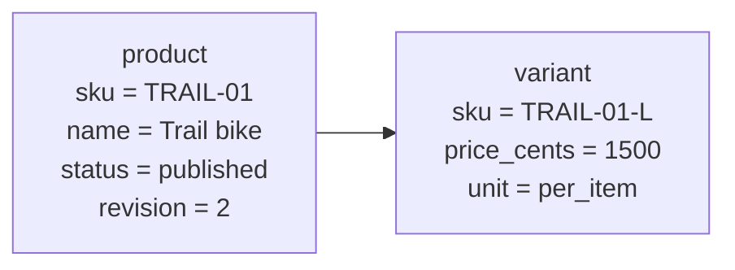
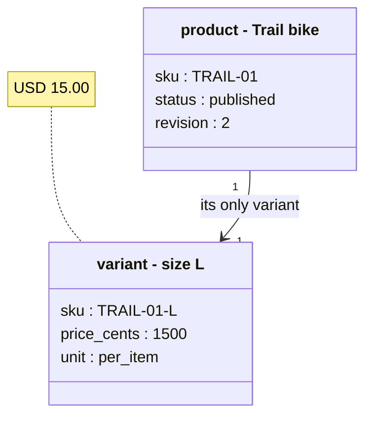

# Mermaid diagrams

Write it, then check it locally. Never send diagram text to a hosted renderer
(`kroki.io`, `mermaid.ink`, `mermaid.live` or any other one): the round trip is slow, and a
diagram often carries private content that you should not paste into a third-party service.
Parse and render on your own machine instead — the sizes in `examples/` were measured with
[Pele](https://pele.run), which runs in a browser or in Node with no network.

## One line per rectangle

A node box holds one line. Several lines pushed into one box become a wall of text.

Bad - four lines in two boxes:

Good - one field per line, in the diagram types built for it:

A `Note` may hold several lines. A node box may not. Also check the rendered width: a long
note runs off a 1010 px PR column, so keep notes short and put the full sentence in the prose.

## Examples

601 blocks over 32 diagram types, copied from <https://pele.run/examples>. One file per type, in `examples/`.

Read one file, not all. `flowchart` is 37 KB, `pie` is 0.4 KB.

| Type | What it is for | Blocks | File |
| --- | --- | --- | --- |
| `block` | Show blocks in a grid that you arrange yourself. | 31 | `examples/block.md` |
| `c4` | Show a software system as people, systems, containers, and components. | 7 | `examples/c4.md` |
| `class` | Show classes, their members, and the relationships between them. | 40 | `examples/class.md` |
| `er` | Show entities, their attributes, and the relationships between them. | 26 | `examples/er.md` |
| `eventmodeling` | Show how commands, events, and views change a system over time. | 13 | `examples/eventmodeling.md` |
| `flowchart` | Show the steps and decisions in a process. | 175 | `examples/flowchart.md` |
| `gantt` | Show the tasks of a project on a timeline. | 11 | `examples/gantt.md` |
| `git` | Show commits, branches, and merges. | 35 | `examples/git.md` |
| `kanban` | Show tasks in columns by status. | 3 | `examples/kanban.md` |
| `mindmap` | Show ideas branching out from a central topic. | 13 | `examples/mindmap.md` |
| `packet` | Show the fields of a network packet. | 5 | `examples/packet.md` |
| `pie` | Show the parts of a whole. | 2 | `examples/pie.md` |
| `quadrant` | Plot items on two axes that divide the chart into four sections. | 4 | `examples/quadrant.md` |
| `requirement` | Show requirements and how they relate to each other and to the elements that satisfy them. | 10 | `examples/requirement.md` |
| `sankey` | Show flows between nodes, with widths proportional to quantity. | 8 | `examples/sankey.md` |
| `sequence` | Show the messages that participants exchange over time. | 39 | `examples/sequence.md` |
| `state` | Show the states of a system and the transitions between them. | 25 | `examples/state.md` |
| `swimlane` | Show a process divided by who performs each step. | 14 | `examples/swimlane.md` |
| `timeline` | Show events in chronological order. | 14 | `examples/timeline.md` |
| `treemap` | Show hierarchical data as nested rectangles, sized by value. | 8 | `examples/treemap.md` |
| `treeview` | Show a hierarchy, such as files and folders. | 14 | `examples/treeview.md` |
| `usecase` | Show actors and the goals they reach with a system. | 24 | `examples/usecase.md` |
| `venn` | Show sets and where they overlap. | 8 | `examples/venn.md` |
| `wardley` | Plot components by their visibility to the user and their stage of evolution. | 20 | `examples/wardley.md` |
| `xychart` | Plot data as bars and lines on two axes. | 8 | `examples/xychart.md` |
| `agentflow` | Show the tasks of AI agents and how work passes between them. | 12 | `examples/agentflow.md` |
| `architecture` | Show services and the connections between them. | 7 | `examples/architecture.md` |
| `cynefin` | Sort items into the five domains of the Cynefin framework. | 3 | `examples/cynefin.md` |
| `ishikawa` | Show the causes that contribute to a problem. | 2 | `examples/ishikawa.md` |
| `journey` | Show the steps of a task and how satisfying each one is. | 2 | `examples/journey.md` |
| `radar` | Compare values across several axes. | 3 | `examples/radar.md` |

## Where this comes from

`examples/` — 601 blocks over 32 diagram types — is copied from
<https://pele.run/examples>, the example set of [Pele](https://pele.run), a Mermaid
renderer by kepano, released under the MIT licence. The full copyright notice travels
with this repo in [NOTICE.md](NOTICE.md).

The two rules above were written while drawing large production sequence diagrams for a
checkout and payment flow. Those diagrams are not part of this skill.
